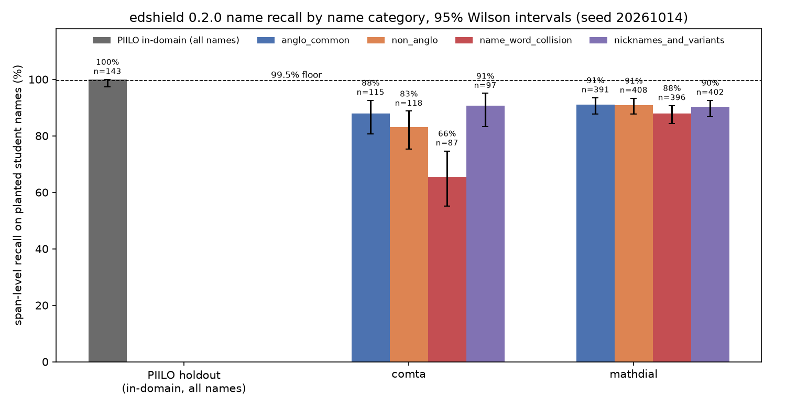

# Genre-shift experiment: edshield 0.2.0 on real tutoring dialogue with planted identifiers

Model: `edshield/piilo-deberta-v3-small` revision `5effafd0299ac576b6c5b3a91b3f26800ce89e62` (weights sha256 `71af3248048b619a…`), rules + model, python runtime on `cuda` (NVIDIA GeForce GTX 1060 6GB). Policy `coppa` sha256 `5831cb4332152883…`. edshield 0.2.0, torch 2.14.1+cu126, transformers 5.19.0. Plant seed 20261014, decode seed 0.

Span recall: gold text no longer occurs whole in the output. Token recall: gold tokens covered by an acted-on entity. 95% Wilson intervals. Over-redaction: acted-on entities per 1,000 whitespace tokens on the untouched control.

Not run: studychat (no raw data present); tscc (no raw data present)

## Recall, in-domain vs real dialogue

| set | identifiers | span recall | 95% CI | strict (no surname left) | mention recall | token recall | student names | span recall | 95% CI | mention recall |
|---|---|---|---|---|---|---|---|---|---|---|
| piilo_holdout | 165 | 100.0% | 97.7% – 100.0% | 99.4% | 99.4% | 99.7% | 143 | 100.0% | 97.4% – 100.0% | 99.3% |
| comta | 621 | 85.3% | 82.3% – 87.9% | 79.2% | 85.8% | 87.7% | 417 | 82.5% | 78.6% – 85.8% | 83.2% |
| mathdial | 2220 | 91.7% | 90.5% – 92.8% | 87.7% | 92.1% | 92.3% | 1597 | 90.0% | 88.4% – 91.4% | 90.5% |
| pooled dialogue | 2841 | 90.3% | 89.2% – 91.4% | 85.9% | 90.7% | 91.2% | 2014 | 88.4% | 87.0% – 89.8% | 89.0% |

Span recall is the residual rule: the identifier's text no longer occurs whole anywhere in the output, so one surviving mention of a name fails every mention of it. Strict span recall also fails a full-name mention whose surname survived (`[CHILD] Green`). Mention recall is per planted span: every token of that mention was covered by an acted-on entity, whatever happened elsewhere in the document; the position and form breakdowns below use it.

## Student-name recall by name category (span level)

All mentions, then base-form mentions only (first and later mentions, no nickname/initial forms), since nickname forms are drawn uniformly across categories and dominate the misses.

| set | category | n | span recall | 95% CI | mention recall | base-form n | base-form span recall | 95% CI | base-form mention recall |
|---|---|---|---|---|---|---|---|---|---|
| comta | anglo_common | 115 | 87.8% | 80.6% – 92.6% | 88.7% | 96 | 96.9% | 91.2% – 98.9% | 97.9% |
| comta | non_anglo | 118 | 83.1% | 75.3% – 88.8% | 86.4% | 100 | 92.0% | 85.0% – 95.9% | 96.0% |
| comta | name_word_collision | 87 | 65.5% | 55.1% – 74.7% | 62.1% | 75 | 70.7% | 59.6% – 79.8% | 66.7% |
| comta | nicknames_and_variants | 97 | 90.7% | 83.3% – 95.0% | 91.8% | 87 | 95.4% | 88.8% – 98.2% | 96.6% |
| mathdial | anglo_common | 391 | 91.0% | 87.8% – 93.5% | 91.0% | 336 | 100.0% | 98.9% – 100.0% | 100.0% |
| mathdial | non_anglo | 408 | 90.9% | 87.8% – 93.3% | 91.7% | 335 | 99.1% | 97.4% – 99.7% | 100.0% |
| mathdial | name_word_collision | 396 | 87.9% | 84.3% – 90.7% | 88.6% | 331 | 95.5% | 92.7% – 97.2% | 96.4% |
| mathdial | nicknames_and_variants | 402 | 90.0% | 86.7% – 92.6% | 90.5% | 331 | 99.4% | 97.8% – 99.8% | 100.0% |
| pooled dialogue | anglo_common | 506 | 90.3% | 87.4% – 92.6% | 90.5% | 432 | 99.3% | 98.0% – 99.8% | 99.5% |
| pooled dialogue | non_anglo | 526 | 89.2% | 86.2% – 91.5% | 90.5% | 435 | 97.5% | 95.5% – 98.6% | 99.1% |
| pooled dialogue | name_word_collision | 483 | 83.9% | 80.3% – 86.9% | 83.9% | 406 | 90.9% | 87.7% – 93.3% | 90.9% |
| pooled dialogue | nicknames_and_variants | 499 | 90.2% | 87.3% – 92.5% | 90.8% | 418 | 98.6% | 96.9% – 99.3% | 99.3% |

## Student-name recall by mention position, nickname form, speaker and case

| set | slice | n | mention recall | 95% CI | span recall (residual rule) |
|---|---|---|---|---|---|
| comta | position: first | 181 | 88.4% | 82.9% – 92.3% | 90.6% |
| comta | position: later | 177 | 92.7% | 87.8% – 95.7% | 88.7% |
| comta | position: nickname | 59 | 39.0% | 27.6% – 51.7% | 39.0% |
| comta | nickname form: all_caps | 9 | 100.0% | 70.1% – 100.0% | 100.0% |
| comta | nickname form: initial | 35 | 0.0% | 0.0% – 9.9% | 0.0% |
| comta | nickname form: truncated | 15 | 93.3% | 70.2% – 98.8% | 93.3% |
| comta | spoken in a student turn | 135 | 85.9% | 79.1% – 90.8% | 88.9% |
| comta | spoken in a tutor turn | 282 | 81.9% | 77.0% – 86.0% | 79.4% |
| comta | written capitalised | 354 | 84.7% | 80.6% – 88.1% | 83.1% |
| comta | written lowercase | 63 | 74.6% | 62.7% – 83.7% | 79.4% |
| mathdial | position: first | 541 | 98.9% | 97.6% – 99.5% | 98.3% |
| mathdial | position: later | 792 | 99.2% | 98.4% – 99.7% | 98.6% |
| mathdial | position: nickname | 264 | 47.0% | 41.0% – 53.0% | 47.0% |
| mathdial | nickname form: all_caps | 48 | 93.8% | 83.2% – 97.9% | 93.8% |
| mathdial | nickname form: initial | 133 | 1.5% | 0.4% – 5.3% | 1.5% |
| mathdial | nickname form: truncated | 83 | 92.8% | 85.1% – 96.6% | 92.8% |
| mathdial | spoken in a student turn | 390 | 91.8% | 88.6% – 94.1% | 91.0% |
| mathdial | spoken in a tutor turn | 1207 | 90.1% | 88.2% – 91.6% | 89.6% |
| mathdial | written capitalised | 1597 | 90.5% | 88.9% – 91.8% | 90.0% |
| pooled dialogue | position: first | 722 | 96.3% | 94.6% – 97.4% | 96.4% |
| pooled dialogue | position: later | 969 | 98.0% | 97.0% – 98.7% | 96.8% |
| pooled dialogue | position: nickname | 323 | 45.5% | 40.2% – 51.0% | 45.5% |
| pooled dialogue | nickname form: all_caps | 57 | 94.7% | 85.6% – 98.2% | 94.7% |
| pooled dialogue | nickname form: initial | 168 | 1.2% | 0.3% – 4.2% | 1.2% |
| pooled dialogue | nickname form: truncated | 98 | 92.9% | 86.0% – 96.5% | 92.9% |
| pooled dialogue | spoken in a student turn | 525 | 90.3% | 87.5% – 92.5% | 90.5% |
| pooled dialogue | spoken in a tutor turn | 1489 | 88.5% | 86.8% – 90.0% | 87.7% |
| pooled dialogue | written capitalised | 1951 | 89.4% | 88.0% – 90.7% | 88.7% |
| pooled dialogue | written lowercase | 63 | 74.6% | 62.7% – 83.7% | 79.4% |

## By label

| set | label | n | span recall | 95% CI |
|---|---|---|---|---|
| piilo_holdout | EMAIL | 4 | 100.0% | 51.0% – 100.0% |
| piilo_holdout | ID_NUM | 7 | 100.0% | 64.6% – 100.0% |
| piilo_holdout | NAME_STUDENT | 143 | 100.0% | 97.4% – 100.0% |
| piilo_holdout | STREET_ADDRESS | 1 | 100.0% | 20.7% – 100.0% |
| piilo_holdout | URL_PERSONAL | 8 | 100.0% | 67.6% – 100.0% |
| piilo_holdout | USERNAME | 2 | 100.0% | 34.2% – 100.0% |
| comta | EMAIL | 12 | 100.0% | 75.8% – 100.0% |
| comta | NAME_RELATED | 91 | 86.8% | 78.4% – 92.3% |
| comta | NAME_STUDENT | 417 | 82.5% | 78.6% – 85.8% |
| comta | PHONE_NUM | 24 | 100.0% | 86.2% – 100.0% |
| comta | SCHOOL | 55 | 92.7% | 82.7% – 97.1% |
| comta | USERNAME | 22 | 90.9% | 72.2% – 97.5% |
| mathdial | EMAIL | 44 | 100.0% | 92.0% – 100.0% |
| mathdial | NAME_RELATED | 292 | 97.9% | 95.6% – 99.1% |
| mathdial | NAME_STUDENT | 1597 | 90.0% | 88.4% – 91.4% |
| mathdial | PHONE_NUM | 68 | 100.0% | 94.7% – 100.0% |
| mathdial | SCHOOL | 163 | 89.0% | 83.2% – 92.9% |
| mathdial | USERNAME | 56 | 100.0% | 93.6% – 100.0% |
| pooled dialogue | EMAIL | 56 | 100.0% | 93.6% – 100.0% |
| pooled dialogue | NAME_RELATED | 383 | 95.3% | 92.7% – 97.0% |
| pooled dialogue | NAME_STUDENT | 2014 | 88.4% | 87.0% – 89.8% |
| pooled dialogue | PHONE_NUM | 92 | 100.0% | 96.0% – 100.0% |
| pooled dialogue | SCHOOL | 218 | 89.9% | 85.2% – 93.2% |
| pooled dialogue | USERNAME | 78 | 97.4% | 91.1% – 99.3% |

## Precision on the planted set and over-redaction on the control

| set | acted spans (planted) | span precision, all labels | acted name spans | name precision | 95% CI | control tokens | control flags | flags / 1,000 tokens | share on curricular terms | control flags by tag |
|---|---|---|---|---|---|---|---|---|---|---|
| piilo_holdout | 344 | 48.5% | 230 | 62.6% | 56.2% – 68.6% | 427681 | 177 | 0.41 | 1.1% | curricular 2, other 175 |
| comta | 563 | 95.6% | 445 | 97.1% | 95.1% – 98.3% | 41759 | 21 | 0.50 | 0.0% | other 21 |
| mathdial | 2291 | 89.3% | 1905 | 91.7% | 90.4% – 92.9% | 185014 | 3000 | 16.21 | 0.0% | other 147, persona 446, problem_name 2407 |

Precision excludes flags on word-problem characters (`problem_name`); on PIILO the all-label figure is not comparable because the coppa policy also masks DATE, AGE and LOCATION, which PIILO does not annotate. `persona` = the MathDial simulated student's own name, left in the control untouched.

Most flagged non-gold strings in the comta control: `john` (4), `khan academy` (3), `samantha` (2), `sara` (2), `30` (1), `rt16x` (1), `sup5` (1), `4900` (1), `johnson` (1), `davis` (1), `hence, ma` (1), `.00000122718463` (1)

Most flagged non-gold strings in the mathdial control: `60` (12), `10` (10), `5` (9), `20` (8), `4` (7), `james` (7), `jane` (6), `lakeisha` (6), `40` (5), `12` (5), `cody` (4), `ty` (4)

## Misses

Reason distribution over all missed planted spans: {'rule_gap': 22, 'collision': 50, 'nickname': 182, 'typo': 4, 'lowercase': 7, 'elsewhere': 10}. Partial residuals (surname survived a masked first name): 127. See `misses.csv`.

## Chart

