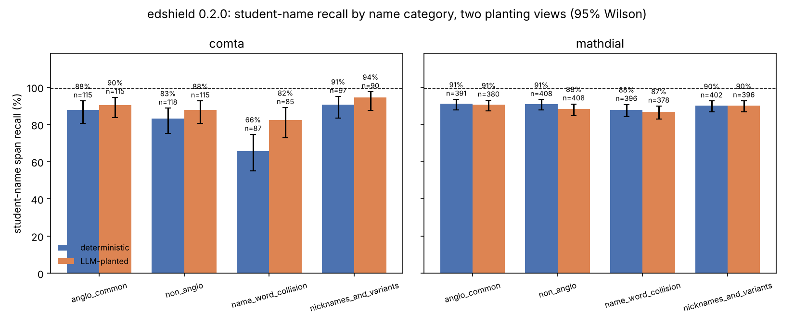

# Deterministic vs LLM-planted view

Same dialogues, same slot decisions (which dialogue gets which identifier kinds, in which turns and forms, and the name category) from the sealed run (seed 20261014); only the wording around each identifier and the choice of name within the category differ. The LLM view was planted by `claude-sonnet-5-5` through the Message Batches API (prompt `prompts/plant_system.md` sha256 `e3ddc4375dbd…`), validated in code, and scored by the unchanged scorer with edshield 0.2.0. Span recall is the residual rule (the identifier no longer occurs whole in the output). Dialogues dropped after one retry: **14** (comta: 5, mathdial: 9).

Sources: `experiments/genre_shift/results/metrics.json` (deterministic, sealed) and `results/llm_view/llm/metrics.json`.

## All identifiers and student names

| slice | det n | det recall | 95% CI | LLM n | LLM recall | 95% CI | Δ pp (LLM − det) | CIs overlap |
|---|---|---|---|---|---|---|---|---|
| comta: all identifiers | 621 | 85.3% | [82.3, 87.9] | 602 | 91.7% | [89.2, 93.6] | +6.3 | **no** |
| comta: student names | 417 | 82.5% | [78.6, 85.8] | 405 | 88.9% | [85.5, 91.6] | +6.4 | yes |
| mathdial: all identifiers | 2220 | 91.7% | [90.5, 92.8] | 2165 | 91.9% | [90.6, 92.9] | +0.2 | yes |
| mathdial: student names | 1597 | 90.0% | [88.4, 91.4] | 1562 | 88.9% | [87.3, 90.4] | -1.1 | yes |
| pooled: all identifiers | 2841 | 90.3% | [89.2, 91.4] | 2767 | 91.8% | [90.8, 92.8] | +1.5 | yes |
| pooled: student names | 2014 | 88.4% | [87.0, 89.8] | 1967 | 88.9% | [87.5, 90.2] | +0.5 | yes |

## Student names by dataset × name category

| slice | det n | det recall | 95% CI | LLM n | LLM recall | 95% CI | Δ pp (LLM − det) | CIs overlap |
|---|---|---|---|---|---|---|---|---|
| comta / anglo_common | 115 | 87.8% | [80.6, 92.6] | 115 | 90.4% | [83.7, 94.6] | +2.6 | yes |
| comta / non_anglo | 118 | 83.1% | [75.3, 88.8] | 115 | 87.8% | [80.6, 92.6] | +4.8 | yes |
| comta / name_word_collision | 87 | 65.5% | [55.1, 74.7] | 85 | 82.4% | [72.9, 89.0] | +16.8 | yes |
| comta / nicknames_and_variants | 97 | 90.7% | [83.3, 95.0] | 90 | 94.4% | [87.6, 97.6] | +3.7 | yes |
| mathdial / anglo_common | 391 | 91.0% | [87.8, 93.5] | 380 | 90.5% | [87.2, 93.1] | -0.5 | yes |
| mathdial / non_anglo | 408 | 90.9% | [87.8, 93.3] | 408 | 88.2% | [84.7, 91.0] | -2.7 | yes |
| mathdial / name_word_collision | 396 | 87.9% | [84.3, 90.7] | 378 | 86.8% | [83.0, 89.8] | -1.1 | yes |
| mathdial / nicknames_and_variants | 402 | 90.0% | [86.7, 92.6] | 396 | 90.2% | [86.8, 92.7] | +0.1 | yes |
| pooled / anglo_common | 506 | 90.3% | [87.4, 92.6] | 495 | 90.5% | [87.6, 92.8] | +0.2 | yes |
| pooled / non_anglo | 526 | 89.2% | [86.2, 91.5] | 523 | 88.1% | [85.1, 90.6] | -1.0 | yes |
| pooled / name_word_collision | 483 | 83.9% | [80.3, 86.9] | 463 | 86.0% | [82.5, 88.8] | +2.1 | yes |
| pooled / nicknames_and_variants | 499 | 90.2% | [87.3, 92.5] | 486 | 90.9% | [88.1, 93.2] | +0.8 | yes |

## Base-form names (no nickname/initial forms) by category, pooled

| slice | det n | det recall | 95% CI | LLM n | LLM recall | 95% CI | Δ pp (LLM − det) | CIs overlap |
|---|---|---|---|---|---|---|---|---|
| anglo_common | 432 | 99.3% | [98.0, 99.8] | 422 | 100.0% | [99.1, 100.0] | +0.7 | yes |
| non_anglo | 435 | 97.5% | [95.5, 98.6] | 432 | 98.4% | [96.7, 99.2] | +0.9 | yes |
| name_word_collision | 406 | 90.9% | [87.7, 93.3] | 389 | 94.1% | [91.3, 96.0] | +3.2 | yes |
| nicknames_and_variants | 418 | 98.6% | [96.9, 99.3] | 408 | 99.8% | [98.6, 100.0] | +1.2 | yes |

## By label, pooled

| slice | det n | det recall | 95% CI | LLM n | LLM recall | 95% CI | Δ pp (LLM − det) | CIs overlap |
|---|---|---|---|---|---|---|---|---|
| EMAIL | 56 | 100.0% | [93.6, 100.0] | 55 | 100.0% | [93.5, 100.0] | +0.0 | yes |
| NAME_RELATED | 383 | 95.3% | [92.7, 97.0] | 373 | 97.9% | [95.8, 98.9] | +2.6 | yes |
| NAME_STUDENT | 2014 | 88.4% | [87.0, 89.8] | 1967 | 88.9% | [87.5, 90.2] | +0.5 | yes |
| PHONE_NUM | 92 | 100.0% | [96.0, 100.0] | 83 | 100.0% | [95.6, 100.0] | +0.0 | yes |
| SCHOOL | 218 | 89.9% | [85.2, 93.2] | 213 | 100.0% | [98.2, 100.0] | +10.1 | **no** |
| USERNAME | 78 | 97.4% | [91.1, 99.3] | 76 | 100.0% | [95.2, 100.0] | +2.6 | yes |

## Nickname forms and case, pooled

| slice | det n | det recall | 95% CI | LLM n | LLM recall | 95% CI | Δ pp (LLM − det) | CIs overlap |
|---|---|---|---|---|---|---|---|---|
| nickname: initial | 168 | 1.2% | [0.3, 4.2] | 164 | 0.0% | [0.0, 2.3] | -1.2 | yes |
| nickname: all_caps | 57 | 94.7% | [85.6, 98.2] | 56 | 89.3% | [78.5, 95.0] | -5.5 | yes |
| nickname: truncated | 98 | 92.9% | [86.0, 96.5] | 96 | 82.3% | [73.5, 88.6] | -10.6 | yes |
| written capitalised | 1951 | 88.7% | [87.2, 90.1] | 1905 | 88.8% | [87.3, 90.1] | +0.0 | yes |
| written lowercase | 63 | 79.4% | [67.8, 87.5] | 62 | 93.5% | [84.6, 97.5] | +14.2 | yes |

## Reading it

A slice where the two views agree within their intervals shows a detector behaviour that does not depend on the sealed run's templates; a slice where they disagree (CIs do not overlap) is one where the phrasing itself moves the number, and the deterministic figure should not be quoted alone. Miss reasons (sealed heuristic tags): deterministic {'rule_gap': 22, 'collision': 50, 'nickname': 182, 'typo': 4, 'lowercase': 7, 'elsewhere': 10}; LLM {'nickname': 188, 'collision': 31, 'lowercase': 1, 'typo': 1, 'elsewhere': 5}.

